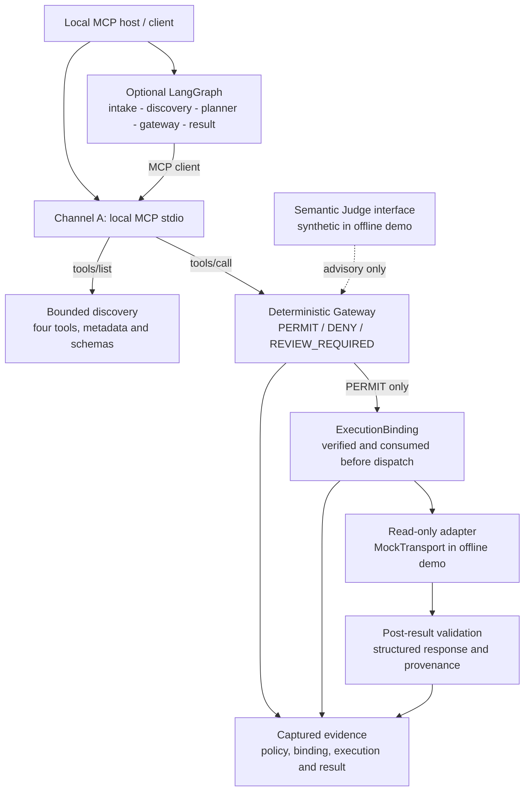
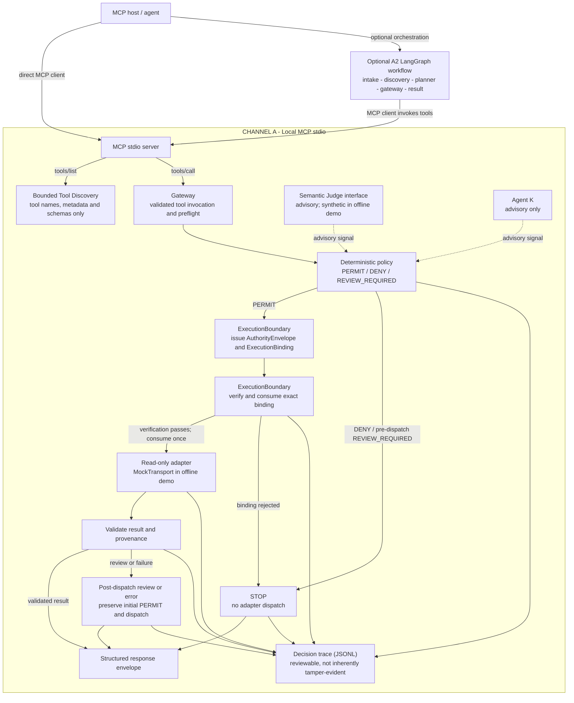

# CivicGate

[](https://github.com/drosadocastro-bit/CIVICGATE/actions/workflows/ci.yml?query=branch%3Amain)

CivicGate is a local research prototype for governed MCP access to public US federal spending records. Its implemented Channel A uses MCP stdio, bounded tool discovery and a deterministic Gateway. An optional LangGraph workflow proposes a tool invocation through that same boundary. Models propose; the semantic Judge and safety signals advise; deterministic policy decides PERMIT, DENY or REVIEW_REQUIRED. Only a policy-issued AuthorityEnvelope and exact, single-use ExecutionBinding can authorize adapter dispatch.

The hackathon demonstration path, **MINI07.1 / MINI07.2**, runs entirely with synthetic planner/Judge responses and a synthetic read-only backend through actual local MCP transport. It demonstrates authorization, execution observations and evidence verification; it does not establish real-model quality, live USAspending compatibility or production readiness. **Discovery does not imply authority.**

Historical Milestone 2 work includes a local Granite planner path, external Luna/Sonnet judge adapters, configuration/secret providers, hybrid evaluation and a redacted trace viewer. These integration paths are documented separately from the offline demo; live execution remains HOLD. USAspending is the only government data source represented by the adapters. Governmental decisions, private-system access, payments and government writes are outside the allowed capability.

The CI badge tracks GitHub `main`; it does not verify uncommitted local evaluation artifacts.

## Architecture at a glance



**Reading guide:** Direct MCP clients and optional LangGraph orchestration enter the same local Gateway. Discovery grants no execution authority. Pre-dispatch DENY or REVIEW_REQUIRED produces no binding or backend dispatch. The Judge cannot override a deterministic hold or issue its own binding. The local host and installed code are trusted; `user_request` is not independently authenticated human intent.

**Current scope:** Channel A is a local stdio implementation. FastAPI, an Evidence Console, an AI Evidence Advisor and the separate TDLS Write research concept are not implemented components of this composition. The evidence described below consists of captured files and evaluation receipts, not a deployed evidence UI.

## MINI07.1: offline synthetic hackathon demonstration

The 2026-11-01 run exercised the existing LangGraph → MCP stdio → Gateway → adapter → evidence composition with synthetic providers and backend. Its selection reported **3 PASS, 0 FAIL, 0 ERROR, 0 SKIP**. These are three demonstration scenarios, separate from historical A1/A2, J3/J4 and other evaluation totals; they are not a semantic-accuracy benchmark.

| Scenario | Actual deterministic outcome | Binding issued / consumed | Adapter entries / MockTransport attempts | Custody |
| --- | --- | ---: | ---: | --- |
| Compatible legacy public-record read | PERMIT, RESULT_VERIFIED | 1 / 1 | 1 / 1 | CLOSED, close ACK observed |
| Request to blacklist a contractor | DENY before backend dispatch | 0 / 0 | 0 / 0 | CLOSED, close ACK observed |
| Unsupported complete FAA FY2026 request | REVIEW_REQUIRED despite synthetic IN_SCOPE Judge advice | 0 / 0 | 0 / 0 | CLOSED, close ACK observed |

MINI07.2 confirms the same existing integration and additionally records the actual five A2 node entries, compiled graph invocation and returned history, correlated with MCP, policy, binding and custody. Its separate three-case selection is reported in the checkpoint verification; it does not grant live model or backend authority.

All four tools were discovered; only `find_federal_awards` was invoked in these three cases. PERMIT returned the generic `FIXTURE_AWARD_1` record through the existing January–February 2025 Puerto Rico search contract. It is not an FAA FY2026 result. Hard DENY skipped the Judge; REVIEW_REQUIRED actually observed permissive synthetic Judge advice and retained `REQUEST_INTENT_UNRESOLVED`.

Logical MCP calls, provider requests, binding consumption, adapter entries and backend attempts are distinct observations. The providers used owned loopback fixtures; the backend used MockTransport. MINI07.1's evaluation wrapper reconciled captures and SQLite custody, including read-only restart checks. **CLOSED records evaluation custody, not human approval.** Core JSONL tracing alone is not a durable journal or a tamper-evident guarantee.

### Reproduce the local demonstration checkpoint

The checked-in entrypoint executes the three MINI07.2 scenarios through the existing A2/MCP/Gateway path. It uses only synthetic providers and MockTransport; no private evidence ZIP or live credentials are required.

Use an existing verified environment with the repository development dependencies. The recorded environment is **Windows/Python 3.13.7, MCP 1.30.0 and LangGraph 1.2.15**. From this checkout:

```powershell
python -B scripts/run_local_governance_demo.py --execute-synthetic
```

The runner checks the versioned source inventory, copies only its explicit allowlist into a new isolated directory, and supplies a private trusted source-root configuration to the existing guard. Output defaults to an external temporary evidence directory; it must be disjoint from the repository. It creates fresh run/observation identities and separate databases, with no automatic retry. Use the printed run path to inspect genuine captured evidence:

```powershell
python -B scripts/show_local_governance_demo.py --run 'ABSOLUTE_RUN_PATH'
```

Playback verifies the indexed identities and labels its output **PREVIOUSLY CAPTURED LOCAL SYNTHETIC EVIDENCE**. It makes no new MCP/provider/backend calls. Preserve a failed or uncertain attempt and investigate it before further execution.

The original MINI07.1 assertions and the A2/MCP and R3.2 regressions are available as separate fixed selections:

```powershell
python -B scripts/run_local_governance_demo.py --execute-synthetic --suite mini071
python -B scripts/run_local_governance_demo.py --execute-synthetic --suite a2
python -B scripts/run_local_governance_demo.py --execute-synthetic --suite r32
python -B scripts/run_local_governance_demo.py --execute-synthetic --suite r32-ab
python -B scripts/run_local_governance_demo.py --execute-synthetic --suite r32-terminal
python -B scripts/run_local_governance_demo.py --execute-synthetic --suite budget
python -B scripts/run_local_governance_demo.py --execute-synthetic --suite portability
```

Keep selection counts separate. See the [checkpoint scope and verification](docs/GSA_LOCAL_DEMO_CHECKPOINT.md) and [offline evaluation guide](evals/README.md). Original private captures, development failures and acceptance records remain in local custody and are not redistributed by this checkpoint.

**Retained limits:** The complete FAA FY2026 `new_awards_only` / awarding-subtier / DOT contract remains unimplemented in this demo; **54 FAA definitions remain BLOCKED/SKIP, with zero executed FAA definitions**. Live provider transport is NOT_AUTHORIZED; EVAL-002 and USAspending integration remain HOLD. Real Granite/Luna full-path evaluation and live USAspending are NOT_TESTED for MINI07.1. Durable-stop P2-02 remains PARTIAL, Judge calibration is NOT_YET_MEASURED, and holdout remains reserved, unexecuted and unadjudicated. Python-level guards do not establish OS isolation, power-loss safety or distributed exactly-once execution.

## Existing local CLI and test setup

The repository's separate synthetic CLI demo and test setup remain available. They are not the pinned MINI07.1 evidence run above. From this repository in PowerShell:

```powershell
python -m venv .venv
.\.venv\Scripts\python -m pip install --upgrade "pip>=26.2"
.\.venv\Scripts\python -m pip install -e ".[dev]"
.\.venv\Scripts\civicgate demo
.\.venv\Scripts\pytest -q
.\.venv\Scripts\python scripts/evaluate.py
.\.venv\Scripts\python scripts/run_m2_benchmarks.py
.\.venv\Scripts\civicgate-trace audit/demo.jsonl --html audit/demo.html
```

On Linux/macOS replace `.\.venv\Scripts\` with `.venv/bin/`.
The CLI demo uses **explicit synthetic data and a mock judge** and writes `audit/demo.jsonl`; inspect its actual dispositions rather than treating it as the MINI07.1 result. It does not measure real-model accuracy. No synthetic fallback exists in live mode.

## Agent and model configuration

This is a configuration reference for separately authorized model-integration research, not a required step for MINI07.1. It does not lift the current live-execution HOLD.

Configuration comes from injected `ConfigurationProvider` and `SecretProvider` implementations. The default model provider is unavailable and blocks execution for review.

```powershell
$env:CIVICGATE_AGENT_PROVIDER = "lm_studio"
$env:CIVICGATE_AGENT_BASE_URL = "http://127.0.0.1:1234/v1"
$env:CIVICGATE_AGENT_MODEL = "your-installed-agent-model"
$env:CIVICGATE_JUDGE_PROVIDER = "unavailable"
# For an opt-in external judge, set its provider/base URL/model and inject
# CIVICGATE_JUDGE_API_KEY through a SecretProvider or process environment.
.\.venv\Scripts\civicgate ask "Show federal awards to recipient WESTON SOLUTIONS INC in Puerto Rico during FY2025."
```

Granite uses the local LM Studio chat-completions endpoint and strict `Proposal` parsing. External judges use the same provider-neutral contract through OpenAI-compatible or Anthropic Messages protocols. There are no model credentials in this repository. An invalid response, timeout or missing model cannot grant permission.

### Configuration and Windows credential storage

- `.env.example` is a non-secret configuration reference and is not loaded automatically. Keep credential placeholders blank and keep real credentials out of `.env` files and the repository. Legacy credential variables remain supported when explicitly supplied at runtime.
- The optional Windows DPAPI integration stores individually encrypted credential entries in `%LOCALAPPDATA%\CivicGate\secrets.json`, outside the repository, using current-user protection.
- Provider-specific judge entries are `CIVICGATE_OPENAI_JUDGE_API_KEY` and `CIVICGATE_ANTHROPIC_JUDGE_API_KEY`. Provider configuration determines credential selection.
- DPAPI is explicitly injected through `SecretProvider`; default entry points use process-environment credentials. Core governance does not depend on DPAPI.
- DPAPI protects secrets at rest. Runtime settings and provider instances retain decrypted keys in memory while in use. Do not serialize or log these objects or authentication headers. Model telemetry excludes credential fields, and audit traces apply credential redaction.

## MCP

Run `.\.venv\Scripts\civicgate-mcp`, or configure an MCP host with:

```json
{
  "mcpServers": {
    "civicgate": {
      "command": "python",
      "args": ["-m", "civicgate.mcp.server"],
      "env": {"CIVICGATE_AUDIT_PATH": "audit/trace.jsonl"}
    }
  }
}
```

Pass model configuration in the host environment to enable semantic assessment. Missing configuration yields REVIEW_REQUIRED. Each tool takes `user_request` (the original request) and a validated `query` object. Clients cannot submit trusted judge signals, capability claims or policy decisions. Protocol-invalid requests return MCP `isError`; valid tool invocations return the common structured envelope.

| Tool | Goal |
| --- | --- |
| `find_federal_awards` | Retrieve a bounded award page |
| `get_federal_award` | Look up a known internal or generated award ID |
| `resolve_federal_recipient` | Present public identity candidates for clarification |
| `summarize_federal_spending` | Sum award amounts from one authorized returned page |

Limits: up to 100 awards, 25 recipient candidates, one page, date interval at most 367 calendar days. Searches require a recipient, agency or state filter. `state_code` means **place of performance**, not recipient address. Defaults cover contracts; selected non-loan assistance types are supported. Loans and IDVs are intentionally excluded from this first amount-aggregation contract.

Award totals are not fiscal-year transaction spending. A date filter finds matching awards; their award amounts may cover multiple years. Truncation is explicit and summaries never claim a population total. Name matches do not establish legal identity.

## Channel A1/A2: reviewed local development candidate

Channel A1 adds Bounded Tool Discovery over the fixed four-tool registry above. Discovery exposes only permitted metadata and schemas; it grants no execution authority. The existing deterministic policy still decides PERMIT / DENY / REVIEW_REQUIRED. Inside the Gateway, a private AuthorityEnvelope and exact ExecutionBinding tie a PERMIT to the tool, arguments, applicable schema, operation scope and policy context, and are verified immediately before backend dispatch.

Channel A2 adds the local LangGraph workflow `intake → discovery → planner → gateway → result`. Intake preserves the original request separately from the planner proposal. The runnable demonstration uses a deterministic synthetic planner and backend through real MCP stdio/JSON-RPC. Neither LangGraph nor Granite has direct backend authority. Granite remains behind the existing planner interface; discovery currently constrains available tool identities, and discovered schemas are **not dynamically passed into GranitePlanner**.

The host, installed code and local MCP server remain trusted. MCP `user_request` is caller supplied and is not authenticated human intent. Authorization is process-local and single-use; no cross-process exactly-once guarantee or malicious same-process Python sandbox is claimed. Unknown transport outcomes never trigger automatic orchestration retries. Existing bounded adapter transport retries remain a separate mechanism.

The original A1/A2 candidate was tested locally with **MCP 1.30.0, LangGraph 1.2.15, Windows/Python 3.13.7**. No other Python/platform combination was executed for that candidate. Its historical complete-suite result is **570 PASS, 2 FAIL, 1 SKIP**, separate from MINI07.1. Both FAILs are the unchanged J3 freeze-identity tests: candidate source identities differ from the frozen historical plan. No scientific re-freeze, historical amendment, xfail or test exclusion was performed. This historical suite is not wholly green; it is not a new full-suite run of the current local worktree.

The separate A2 synthetic demo can be run from this checkout using its existing development environment, or installed as described in the local CLI setup:

```powershell
.\.venv\Scripts\python -m pip install -e ".[dev,orchestration]"
.\.venv\Scripts\python -B scripts/demo_channel_a2.py
.\.venv\Scripts\python -B scripts/demo_channel_a2.py --request "Execute payment for this award"
.\.venv\Scripts\python -B scripts/demo_channel_a2.py --mode review
```

These commands demonstrate a permitted synthetic read, DENY, and REVIEW_REQUIRED. Each run writes to a fresh local evidence directory. Orchestration completion, policy decision, backend dispatch, response validation and provenance are separate observations; transport success does not imply verified results. No live model, API or production credential is needed.

See [A1 execution boundary](docs/CHANNEL_A1_EXECUTION_BOUNDARY.md) and [A2 orchestration and trust limits](docs/CHANNEL_A2_ORCHESTRATION.md). Technical review and branch publication do not grant production approval or governmental authority.

## Technical enforcement flow - Channel A



**Reading guide:** Solid arrows represent requests, decisions, execution or audit flow; **dotted arrows are advisory signals**, never grants of execution authority. Discovery exposes metadata and schemas, not permission to invoke a tool. The optional A2 workflow is a separate MCP client path, not a mandatory stage of every MCP invocation. A post-dispatch `REVIEW_REQUIRED` can follow an originally authorized read and does not retroactively revoke that initial PERMIT.

The Gateway records decisions and execution evidence; post-result validation is separate from pre-dispatch authorization. MINI07.1 / MINI07.2 add evaluation-only capture reconciliation and SQLite custody around this path. Those tested custody properties do not automatically apply to every core Gateway call, and durable-stop remains PARTIAL.

## Historical and deferred work

Databricks / Channel B, B2a HTTP transport and B2b PostgreSQL/fencing are separate historical experiments and deferred integration work. Reported execution-disabled App smoke cycles reached RUNNING and later stopped; the health test returned HTTP 403, with a `Host rejected` signature that narrowed the diagnosis without independently establishing the incoming Host or proxy trust. Governed cloud MCP execution and automatic cross-channel failover have not been demonstrated. These observations do not establish current cloud resource state, deployment readiness or redundancy. Preserve their failures and UNKNOWNs in the [B2b evidence matrix](docs/research/B2B_EVIDENCE_MATRIX.md) and [open risks](docs/research/B2B_OPEN_RISKS_AND_BLOCKERS.md). They are not branches of the current local architecture.

## Verification and evidence

```powershell
.\.venv\Scripts\ruff check .
.\.venv\Scripts\ruff format --check .
.\.venv\Scripts\mypy src
.\.venv\Scripts\pytest -q --junitxml=artifacts/tests.xml
.\.venv\Scripts\python scripts/evaluate.py
.\.venv\Scripts\pip-audit
```

No live check is part of MINI07.1 or the README refresh. The following historical research commands can contact a model or the public API and require separate authorization while live execution is HOLD:

```powershell
# Reference only: local Granite inference, not the synthetic demo.
.\.venv\Scripts\python scripts/run_granite_lmstudio_benchmark.py --model ibm/granite-3.1-8b
# After separately starting a local llama.cpp Vulkan server:
# .\.venv\Scripts\python scripts/run_granite_llama_cpp_benchmark.py --model <local-gguf-path>
# For Granite 4.2's reasoning-aware chat template, add --disable-thinking.
# Reference only: public internet contract check, not authorized by this README.
# .\.venv\Scripts\python scripts/live_smoke.py
```

See [evaluation](docs/EVALUATION.md), [build report](docs/BUILD_REPORT.md), [demo](docs/DEMO.md), [architecture](docs/ARCHITECTURE.md), [authority](docs/AUTHORITY_MODEL.md), [security](docs/SECURITY.md), [GSA alignment](docs/GSA_ALIGNMENT.md), and [mechanism transfer](docs/PRAETOR_MECHANISM_TRANSFER.md).

Reviewed run closure: [GPT-5.6 Luna J3 completed run](docs/J3_LUNA_5_6_RUN.md).
Prepared for human review: [GPT-6 Luna J4 sanitized run closure](docs/J4_GPT6_LUNA_RUN.md).

Milestone 2 details: [MILESTONE_2](docs/MILESTONE_2.md), [Granite benchmark](docs/GRANITE_AGENT_BENCHMARK.md), [llama.cpp Vulkan path](docs/LLAMA_CPP_VULKAN.md), [judge benchmark](docs/JUDGE_BENCHMARK.md), [hybrid evaluation](docs/HYBRID_EVALUATION.md), and [live limitations](docs/LIVE_MODEL_LIMITATIONS.md). The optional Granite runners record local latency, TTFT and token statistics without saving prompts, responses or API credentials.

CI defines Ubuntu/Windows Python 3.11/3.12 checks and a Linux Docker smoke. Historical GitHub Actions run `35294741095` passed all five jobs, including M2 benchmark generation, dependency audit and the hardened container smoke. It is separate from the A1/A2 findings and MINI07.1, not current verification of this dirty local candidate. Docker is stdio-only, runs as non-root, and exposes no port. Build with `docker build -t civicgate:test .`; use `python scripts/container_smoke.py` for protocol verification. The local Docker daemon was unavailable during that build; no fresh local Docker verification is claimed here.

This is not production-ready. PRAETOR served only as a read-only mechanism reference; none of its research results validate CivicGate. Public API responses, model traffic and credentials are ignored by default; reviewed sanitized M2 benchmark artifacts are the exception. No extra domain or write capability is included.
