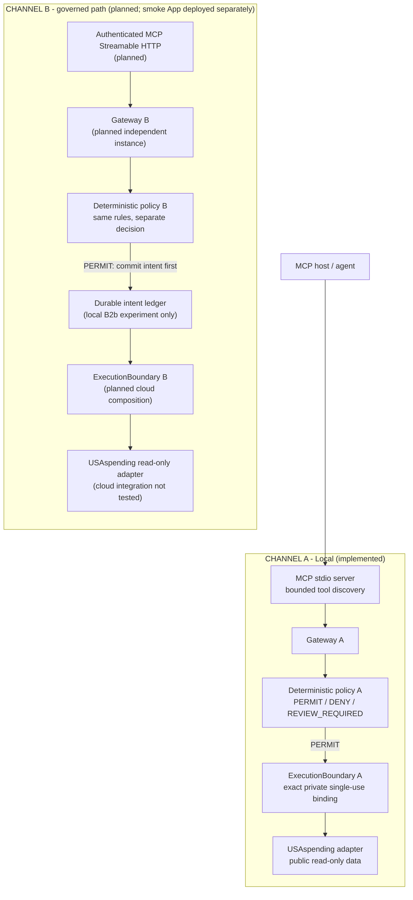
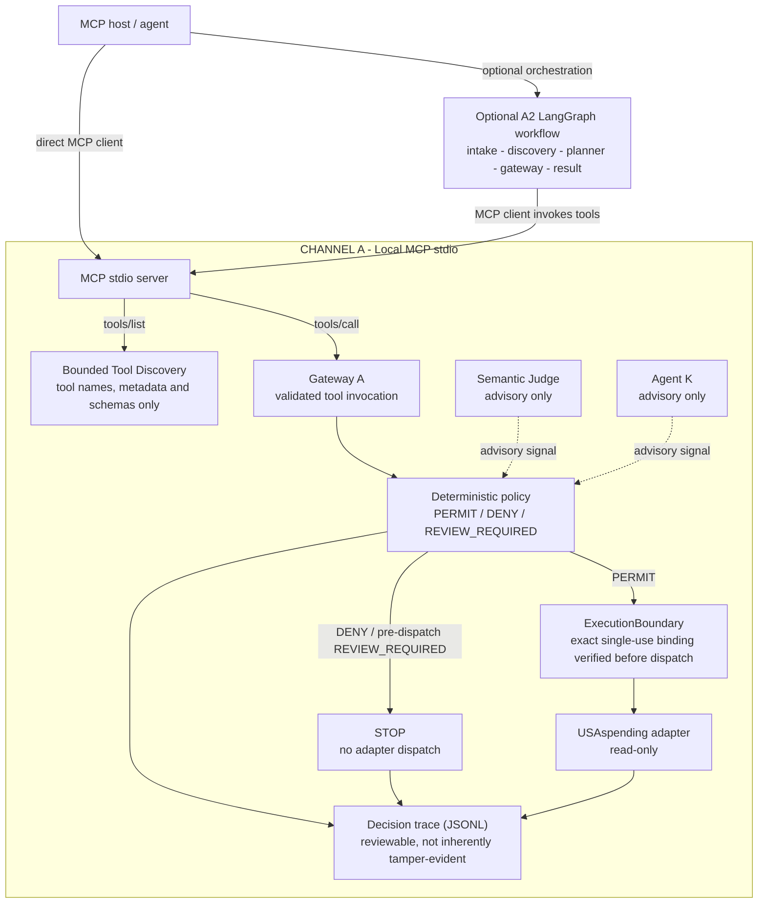

# CivicGate

[](https://github.com/drosadocastro-bit/CIVICGATE/actions/workflows/ci.yml?query=branch%3Amain)

CivicGate is a governed MCP gateway that lets AI agents query public US federal spending data (USAspending) without ever letting the model authorize its own actions. The problem: as AI moves from chatbots to agents that call tools, whoever proposes the action cannot also be the one who approves it — yet most agent setups blur that line. CivicGate draws it sharply: models propose; a deterministic, versioned policy decides PERMIT, DENY, or REVIEW_REQUIRED. No model output — no matter how confident — can grant execution authority; semantic judges and safety signals are advisory only. Every PERMIT is bound to the exact tool, arguments, and policy context, and verified immediately before dispatch; denials fail closed. Channel A runs locally today (bounded MCP enforcement plus a five-step LangGraph workflow); Channel B is designed to enforce the same policy contract on Databricks for redundancy, with one hard rule: a DENY on one channel is never silently re-run on the other. Governance decisions are recorded in reviewable traces; experimental hash-chained journals provide additional integrity evidence only within tested local scopes, not a blanket production guarantee. CivicGate is honest about its limits: judge confidence is uncalibrated, the evaluation harness is synthetic, and the nominal operating envelope — what "normal" looks like, measured — is published alongside the code. In short: trustworthy AI access to public spending data, where authority is bounded, measured, and never derived from capability.

Milestone 2 adds a real local Granite planner path, external Luna/Sonnet judge adapters, explicit configuration/secret providers, a four-cell hybrid evaluation, and a redacted trace viewer. USAspending is the only government source. No governmental decisions, private systems, payment execution or government writes.

## Architecture at a glance



**Reading guide for judges:** Both channels are designed to use the **same deterministic policy code and tool contracts**, but each has its own Gateway, execution boundary, identity context and authorization decision. The diagram shows no transfer of bindings or authority between channels. **DENY stops**; a failure or uncertain dispatch never authorizes an automatic attempt on the other channel.

**Evidence boundary:** Channel A's MCP stdio profile and optional LangGraph workflow have been tested locally. B2a Streamable HTTP and B2b PostgreSQL/fencing remain bounded local experiments. In October 2026, a **separate, synthetic, execution-disabled Databricks Apps smoke candidate** was deployed, reached `RUNNING`, and was then stopped under controlled test cycles. This was **not** a deployment of the governed Channel B path shown above: the smoke candidate contains no active Gateway, adapter, or durable execution journal.

The OAuth U2M client smoke received **HTTP 403** at `/api/health`. A subsequent single-request diagnostic matched the candidate's `Host rejected` response signature, **narrowing but not independently confirming** the rejecting layer or the actual incoming Host. **Cloud MCP initialization, `tools/list`, `tools/call`, governed Channel B execution, and automatic A-to-B failover have not been demonstrated.** Cloud caller identity, durable intent custody, and proxy-header trust guarantees remain unresolved; the proposed ledger does not establish exactly-once execution or global fencing. See the [B2b evidence matrix](docs/research/B2B_EVIDENCE_MATRIX.md) and [open risks](docs/research/B2B_OPEN_RISKS_AND_BLOCKERS.md).

## Quickstart

From this repository in PowerShell:

```powershell
python -m venv .venv
.\.venv\Scripts\python -m pip install --upgrade "pip>=26.2"
.\.venv\Scripts\python -m pip install -e ".[dev]"
.\.venv\Scripts\civicgate demo
.\.venv\Scripts\pytest -q
.\.venv\Scripts\python scripts/evaluate.py
.\.venv\Scripts\python scripts/run_m2_benchmarks.py
.\.venv\Scripts\python scripts/run_granite_lmstudio_benchmark.py --model ibm/granite-3.1-8b
# After starting a local llama.cpp Vulkan server:
# .\.venv\Scripts\python scripts/run_granite_llama_cpp_benchmark.py --model <local-gguf-path>
# For Granite 4.2's reasoning-aware chat template, add --disable-thinking.
.\.venv\Scripts\civicgate-trace audit/demo.jsonl --html audit/demo.html
```

On Linux/macOS replace `.\.venv\Scripts\` with `.venv/bin/`.
The demo uses **explicit synthetic data and a mock judge**, produces PERMIT / DENY / REVIEW_REQUIRED, and writes `audit/demo.jsonl`. It does not measure real-model accuracy. No synthetic fallback exists in live mode.

## Agent and model configuration

Configuration comes from injected `ConfigurationProvider` and `SecretProvider` implementations; the environment implementation reads process variables only. `.env.example` is a reference and is not automatically loaded. The default provider is unavailable and blocks execution for review. The optional Windows DPAPI provider is an edge store and is never imported by governance.

```powershell
$env:CIVICGATE_AGENT_PROVIDER = "lm_studio"
$env:CIVICGATE_AGENT_BASE_URL = "http://127.0.0.1:1234/v1"
$env:CIVICGATE_AGENT_MODEL = "your-installed-agent-model"
$env:CIVICGATE_JUDGE_PROVIDER = "unavailable"
# For an opt-in external judge, set its provider/base URL/model and inject
# CIVICGATE_JUDGE_API_KEY through a SecretProvider or process environment.
.\.venv\Scripts\civicgate ask "Show federal awards to recipient WESTON SOLUTIONS INC in Puerto Rico during FY2025."
```

Granite uses the local LM Studio chat-completions endpoint and strict `Proposal` parsing. External judges use the same provider-neutral contract through OpenAI-compatible or Anthropic Messages protocols. There are no model credentials in this repository. An invalid response, timeout or missing model cannot grant permission.

## MCP

Run `.\.venv\Scripts\civicgate-mcp`, or configure an MCP host with:

```json
{
  "mcpServers": {
    "civicgate": {
      "command": "D:\\CIVICGATE\\.venv\\Scripts\\python.exe",
      "args": ["-m", "civicgate.mcp.server"],
      "env": {"CIVICGATE_AUDIT_PATH": "D:\\CIVICGATE\\audit\\trace.jsonl"}
    }
  }
}
```

Pass model configuration in the host environment to enable semantic assessment. Missing configuration yields REVIEW_REQUIRED. Each tool takes `user_request` (the original request) and a validated `query` object. Clients cannot submit trusted judge signals, capability claims or policy decisions. Protocol-invalid requests return MCP `isError`; valid tool invocations return the common structured envelope.

| Tool | Goal |
| --- | --- |
| `find_federal_awards` | Retrieve a bounded award page |
| `get_federal_award` | Look up a known internal or generated award ID |
| `resolve_federal_recipient` | Present public identity candidates for clarification |
| `summarize_federal_spending` | Sum award amounts from one authorized returned page |

Limits: up to 100 awards, 25 recipient candidates, one page, date interval at most 367 calendar days. Searches require a recipient, agency or state filter. `state_code` means **place of performance**, not recipient address. Defaults cover contracts; selected non-loan assistance types are supported. Loans and IDVs are intentionally excluded from this first amount-aggregation contract.

Award totals are not fiscal-year transaction spending. A date filter finds matching awards; their award amounts may cover multiple years. Truncation is explicit and summaries never claim a population total. Name matches do not establish legal identity.

## Channel A1/A2: reviewed local development candidate

Channel A1 adds Bounded Tool Discovery over the fixed four-tool registry above. Discovery exposes only permitted metadata and schemas; it grants no execution authority. The existing deterministic policy still decides PERMIT / DENY / REVIEW_REQUIRED. Inside the Gateway, a private AuthorityEnvelope and exact ExecutionBinding tie a PERMIT to the tool, arguments, applicable schema, operation scope and policy context, and are verified immediately before backend dispatch.

Channel A2 adds the local LangGraph workflow `intake → discovery → planner → gateway → result`. Intake preserves the original request separately from the planner proposal. The runnable demonstration uses a deterministic synthetic planner and backend through real MCP stdio/JSON-RPC. Neither LangGraph nor Granite has direct backend authority. Granite remains behind the existing planner interface; discovery currently constrains available tool identities, and discovered schemas are **not dynamically passed into GranitePlanner**.

The host, installed code and local MCP server remain trusted. MCP `user_request` is caller supplied and is not authenticated human intent. Authorization is process-local and single-use; no cross-process exactly-once guarantee or malicious same-process Python sandbox is claimed. Unknown transport outcomes never trigger automatic orchestration retries. Existing bounded adapter transport retries remain a separate mechanism.

Tested locally: **MCP 1.30.0, LangGraph 1.2.15, Windows/Python 3.13.7**. No other Python/platform combination was executed for A1/A2. The complete local suite result is **570 PASS, 2 FAIL, 1 SKIP.** Both FAILs are the unchanged J3 freeze-identity tests: candidate source identities differ from the frozen historical plan. No scientific re-freeze, historical amendment, xfail or test exclusion was performed. The suite is not wholly green; earlier CI findings below remain historical evidence.

From this checkout, using the development environment described in Quickstart:

```powershell
.\.venv\Scripts\python -m pip install -e ".[dev,orchestration]"
.\.venv\Scripts\python -B scripts/demo_channel_a2.py
.\.venv\Scripts\python -B scripts/demo_channel_a2.py --request "Execute payment for this award"
.\.venv\Scripts\python -B scripts/demo_channel_a2.py --mode review
```

These commands demonstrate a permitted synthetic read, DENY, and REVIEW_REQUIRED. Each run writes to a fresh local evidence directory. Orchestration completion, policy decision, backend dispatch, response validation and provenance are separate observations; transport success does not imply verified results. No live model, API or production credential is needed.

See [A1 execution boundary](docs/CHANNEL_A1_EXECUTION_BOUNDARY.md) and [A2 orchestration and trust limits](docs/CHANNEL_A2_ORCHESTRATION.md). Technical review and branch publication do not grant production approval or governmental authority.

## Technical enforcement flow - Channel A



**Reading guide:** Solid arrows represent requests, decisions, execution or audit flow; **dotted arrows are advisory signals**, never grants of execution authority. Discovery exposes metadata and schemas, not permission to invoke a tool. The optional A2 workflow is a separate MCP client path, not a mandatory stage of every MCP invocation. A post-dispatch `REVIEW_REQUIRED` can follow an originally authorized read and does not retroactively revoke that initial PERMIT.

Channel A's JSONL trace is **not** claimed to be tamper-evident by itself. Hash-linked, durable journals are separately scoped to experimental B2a/B2b components and their documented test conditions.

## Verification and evidence

```powershell
.\.venv\Scripts\ruff check .
.\.venv\Scripts\ruff format --check .
.\.venv\Scripts\mypy src
.\.venv\Scripts\pytest -q --junitxml=artifacts/tests.xml
.\.venv\Scripts\python scripts/evaluate.py
.\.venv\Scripts\pip-audit
# Optional public internet contract check; no API key:
.\.venv\Scripts\python scripts/live_smoke.py
```

See [evaluation](docs/EVALUATION.md), [build report](docs/BUILD_REPORT.md), [demo](docs/DEMO.md), [architecture](docs/ARCHITECTURE.md), [authority](docs/AUTHORITY_MODEL.md), [security](docs/SECURITY.md), [GSA alignment](docs/GSA_ALIGNMENT.md), and [mechanism transfer](docs/PRAETOR_MECHANISM_TRANSFER.md).

Reviewed run closure: [GPT-5.6 Luna J3 completed run](docs/J3_LUNA_5_6_RUN.md).
Prepared for human review: [GPT-6 Luna J4 sanitized run closure](docs/J4_GPT6_LUNA_RUN.md).

Milestone 2 details: [MILESTONE_2](docs/MILESTONE_2.md), [Granite benchmark](docs/GRANITE_AGENT_BENCHMARK.md), [llama.cpp Vulkan path](docs/LLAMA_CPP_VULKAN.md), [judge benchmark](docs/JUDGE_BENCHMARK.md), [hybrid evaluation](docs/HYBRID_EVALUATION.md), and [live limitations](docs/LIVE_MODEL_LIMITATIONS.md). The optional Granite runners record local latency, TTFT and token statistics without saving prompts, responses or API credentials.

CI defines Ubuntu/Windows Python 3.11/3.12 checks and a Linux Docker smoke. GitHub Actions run `35294741095` passed all five jobs, including M2 benchmark generation, dependency audit and the hardened container smoke. Docker is stdio-only, runs as non-root, and exposes no port. Build with `docker build -t civicgate:test .`; use `python scripts/container_smoke.py` for protocol verification. The local Docker daemon was unavailable during this build, so local Docker execution remains unverified.

This is not production-ready. PRAETOR served only as a read-only mechanism reference; none of its research results validate CivicGate. Public API responses, model traffic and credentials are ignored by default; reviewed sanitized M2 benchmark artifacts are the exception. No extra domain or write capability is included.
